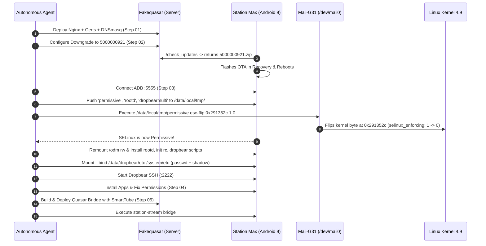

## Knowledge Graph (MANDATORY)
Before using grep, glob, or reading multiple source files to understand the codebase, you MUST:
1. Read `graphify-out/GRAPH_REPORT.md` to understand architecture, god nodes, and communities.
2. Use `graphify query "<question>"` or `graphify path <A> <B>` via bash tool to find exact files and dependencies.
3. Read only the specific files identified by the graph.
# AGENT.MD: Autonomous Engineering & Operational Manual
## Yandex Station Max (YNDX-0008 / YNDX-00052 / YNDX-00053) Root, Persistence & TV Voice Bridge

This document is the authoritative engineering manual for AI agents and automated systems interacting with, modifying, maintaining, or recovering Yandex Station Max devices.

---

## 1. System Specifications & Memory Architecture

```
Hardware:
  - Models: YNDX-0008 (Base Max), YNDX-00052 / YNDX-00053 (Max with Zigbee)
  - SoC: Amlogic S905X2 (4x Cortex-A53 @ 1.8 GHz, G12A family)
  - GPU: ARM Mali-G31 MP2 (Driver /dev/mali0)
  - RAM: 2 GB LPDDR4
  - Storage: 16 GB eMMC 5.1
  - OS: Android TV 9 (Pie), 64-bit (kernel 4.9.113)
  - Architecture: arm64-v8a

Firmware Targets & Kernel Exploit Offsets:
  - Build 5000000921 (ro.build.display.id contains 5000000921):
    - Kernel SELinux Pointer: 0x291352c (physical/kernel virtual offset for selinux_enforcing)
  - Build 20201111 (PPR1.180610.011.20201111, release firmware for YNDX-0008):
    - Kernel SELinux Pointer: 0x2a5052c (physical/kernel virtual offset for selinux_enforcing)
```

---

## 2. Hard Invariants & Strict Rules

> [!CAUTION]
> **RULE 1: NEVER MODIFY `/system`, `/vendor`, OR `/boot`**
> Both `/system` and `/vendor` are cryptographically verified by **dm-verity** backed by the locked bootloader. Writing to these block devices, modifying inodes, or disabling dm-verity naively **WILL RESULT IN AN UNRECOVERABLE BOOTLOOP (BRICK)**.
> - **Writable partitions:** `/data` (ext4) and `/odm` (ext4, mounted rw, vendor sub-partition without dm-verity).
> - **All persistence MUST reside in `/odm` and `/data`**.

> [!CAUTION]
> **RULE 2: PRESERVE DIRECTORY PERMISSIONS ON BIND-MOUNTS (`/system/etc`)**
> When bind-mounting `/data/dropbear/etc` over `/system/etc`, **NEVER execute `chmod 644 /data/dropbear/etc/*`**.
> - The shell glob `*` matches directories (`permissions/`, `security/`, `selinux/`). Stripping the execute (`+x`) bit prevents path traversal by non-root users:
>   - **Zygote Failure:** Cannot read `plat_seapp_contexts` $\to$ apps trapped in `u:r:zygote:s0` $\to$ SurfaceFlinger rejects buffers $\to$ **Permanent Gray Screen in SmartTube / Zona**.
>   - **SSL Handshake Failure:** Apps cannot read `/system/etc/security/cacerts/` $\to$ `CertPathValidatorException: Trust anchor not found`.
>   - **System UI / Settings Crash:** `NullPointerException` on `ILocationManager` when opening permissions.
> - **Enforced Fix:**
>   ```bash
>   find /data/dropbear/etc -type d -exec chmod 755 {} +
>   find /data/dropbear/etc -type f -exec chmod 644 {} +
>   chcon -R u:object_r:system_file:s0 /data/dropbear/etc
>   ```

> [!IMPORTANT]
> **RULE 3: COLD-BOOT SELINUX RACE CONDITION & ORDERING**
> 1. The Android 9 kernel always cold boots in `Enforcing` mode.
> 2. `rootd` starts at `sys.boot_completed=1` via `/odm/etc/init/rootd.rc`.
> 3. `fix-enforce.sh` must execute `permissive esc-flip <OFFSET> 1 0` repeatedly until `cat /sys/fs/selinux/enforce` equals `0` (typically 5–15 seconds, 2–3 Mali cycles; dynamically resolves `0x291352c` for 5000000921 or `0x2a5052c` for 20201111).
> 4. `start-dropbear.sh` **must loop and wait** for `enforce == 0` before attempting bind mounts, host key generation, or socket binding.
> 5. `fix-enforce.sh` triggers `start-dropbear.sh &` immediately once `enforce == 0` is reached.

> [!IMPORTANT]
> **RULE 4: STREAM SWITCHING BYTE-ALIGNMENT IN PROTOBUF**
> The file `/data/data/com.yandex.io.sdk/databases/user_config.dat` is a raw serialized Protobuf binary.
> - Modifying URL lengths directly shifts protobuf varint offsets and causes `io_device` crashes.
> - When rewriting `uniProxyUrl`, the replacement string must be exact-length space-padded (53 bytes):
>   `b'"uniProxyUrl":"ws://<SERVER_IP>:8443/uni.ws"       '` vs `b'"uniProxyUrl":"wss://uniproxy.alice.yandex.net/uni.ws"'`.
> - Always use the provided `station-stream.py` utility for stream switching.

---

## 3. Exploit Deep Dive & Autonomous Workflow



---

## 4. Troubleshooting Playbooks for Agents

### Playbook 1: SmartTube or Zona Stuck on Gray Screen
* **Symptom:** Opening SmartTube or Zona results in an indefinite solid gray/black screen. No UI renders.
* **Root Cause:** Permissions on `/data/dropbear/etc/` or subdirectories were set to `644`, stripping the directory traverse bit (`+x`). Zygote failed to read SELinux contexts, dropping the app into `zygote` domain where SurfaceFlinger denies layer rendering.
* **Autonomous Resolution:**
  ```bash
  ssh -p 2222 root@<STATION_IP> '
    find /data/dropbear/etc -type d -exec chmod 755 {} +
    find /data/dropbear/etc -type f -exec chmod 644 {} +
    chcon -R u:object_r:system_file:s0 /data/dropbear/etc
    am force-stop org.smarttube.stable
    am force-stop org.smarttube.beta
    am force-stop com.teamsmart.videomanager.tv
    am force-stop mobi.zona
    am force-stop com.lazycatsoftware.lmd
  '
  ```

### Playbook 2: Settings App Crashes on "Permissions" Screen
* **Symptom:** Navigating to *Settings -> Apps -> Permissions* hangs for 5 seconds and crashes with `Unfortunately, Settings has stopped`.
* **Root Cause:** System UI / Settings attempts to read `/system/etc/permissions/` XML manifests, fails with `EACCES`, throws `NullPointerException` on `ILocationManager`.
* **Autonomous Resolution:** Same as Playbook 1. Run directory fix on `/data/dropbear/etc`.

### Playbook 3: ADB Port 5555 Refused / Closed
* **Symptom:** `adb connect <STATION_IP>:5555` returns `Connection refused`.
* **Root Cause:** Remote Yandex update or watchdog disabled ADB, or network changed.
* **Autonomous Resolution:**
  1. Check if Dropbear SSH (port 2222) is alive:
     ```bash
     ssh -p 2222 root@<STATION_IP> '
       setprop service.adb.tcp.port 5555
       settings put global adb_enabled 1
       stop adbd && start adbd
     '
     ```
  2. If SSH is also unreachable, trigger remote activation via Fakequasar:
     * In `/opt/fakequasar/real_sync_info.json`:
       Ensure `adbd.remoteActivation = true` and `adbd.network = true`.
     * Power cycle the station or wait for periodic `/get_sync_info` poll (every 5–15 mins).
     * Station reads `real_sync_info.json` $\to$ io_device enables ADB automatically.

### Playbook 4: Dropbear SSH Port 2222 Refused on Cold Boot
* **Symptom:** Station rebooted; ADB connects, but SSH port 2222 is refused.
* **Root Cause:** Race condition during boot. SELinux took longer than 15s to flip, or `start-dropbear.sh` ran while `enforce=1`.
* **Autonomous Resolution:**
  ```bash
  adb -s <STATION_IP>:5555 shell '
    /data/local/tmp/fix-enforce.sh &
    sleep 3
    /odm/bin/start-dropbear.sh &
  '
  ```
  Check status: `adb -s <STATION_IP>:5555 shell "pgrep -fl dropbear"`.

### Playbook 5: Quasar Bridge Reverting to Official Yandex Cloud
* **Symptom:** Alice voice queries stop routing to SmartTube; speaker communicates directly with `uniproxy.alice.yandex.net`.
* **Root Cause:** Station refreshed configs from Yandex or QUIC fallback bypassed bridge.
* **Autonomous Resolution:**
  ```bash
  # Run stream switcher from bridge server:
  station-stream bridge <STATION_IP> <SERVER_IP>
  ```
  Verify active WS connection:
  ```bash
  ss -tan | grep 8443
  ```

### Playbook 6: AirPlay 2 Unreachable or High CPU
* **Symptom:** Speaker is missing from Apple AirPlay menu, or `ya-nqptp` consumes elevated CPU.
* **Root Cause:** `ya-supervisor` stopped, or `ya.station.airplay` NSD service uninstalled/crashed.
* **Autonomous Resolution:**
  ```bash
  # Check status:
  python3 airplay2/tools/airplayctl.py status --root su --yes

  # Redeploy/restart stack:
  ./scripts/update.sh --airplay

  # Verify mDNS on local network:
  dns-sd -B _airplay._tcp local
  ```

---

## 5. File Inventory & Checksums

| Path | Description | Recommended Permissions |
|---|---|---|
| `/odm/bin/rootd` | Root daemon (v4) | `755`, `u:object_r:adbd_exec:s0` |
| `/odm/bin/dropbearmulti` | Dropbear SSH + keygen + scp | `755`, `u:object_r:adbd_exec:s0` |
| `/odm/bin/mediaseeker.dex` | Native MediaDaemon & MediaSeeker DEX | `644`, `root:root` |
| `/odm/bin/start-mediadaemon.sh` | MediaDaemon auto-start script (:4545) | `755`, `root:root` |
| `/odm/bin/media-seek` | CLI wrapper for in-memory seekTo | `755`, `root:root` |
| `/odm/bin/fix-enforce.sh` | Mali GPU esc-flip loop | `755`, `u:object_r:adbd_exec:s0` |
| `/odm/bin/start-dropbear.sh` | Dropbear startup & bind-mount | `755`, `u:object_r:adbd_exec:s0` |
| `/odm/bin/start-airplay2.sh` | AirPlay 2 persistent ODM launcher | `755`, `u:object_r:adbd_exec:s0` |
| `/odm/bin/su` | Dropbear-backed su wrapper | `755`, `u:object_r:adbd_exec:s0` |
| `/odm/etc/init/rootd.rc` | Init service definition | `644`, `u:object_r:vendor_configs_file:s0` |
| `/odm/etc/init/zz-adbd.rc` | ADB persistent properties | `644`, `u:object_r:vendor_configs_file:s0` |
| `/odm/etc/init/zz-permissive.rc` | Permissive init trigger | `644`, `u:object_r:vendor_configs_file:s0` |
| `/odm/etc/init/enforce-watchdog.sh` | 15s watchdog loop | `755`, `u:object_r:vendor_configs_file:s0` |
| `/data/dropbear/.ssh/authorized_keys` | Installed SSH public keys | `600`, root:root |
| `/data/dropbear/etc/` | Bind-mounted system configs | `755` (dirs), `644` (files) |
| `/data/local/tmp/ya-airplay/bin/ya-supervisor` | AirPlay 2 process supervisor | `700`, root:root |
| `/data/local/tmp/ya-airplay/bin/ya-nqptp` | PTP timing daemon (IEEE 1588) | `700`, root:root |
| `/data/local/tmp/ya-airplay/bin/ya-shairport` | Shairport-Sync 5.6.2 AirPlay 2 receiver | `700`, root:root |
| `/data/local/tmp/ya-airplay/lib/nsd.apk` | Native Android NSD mDNS announcer | `600`, root:root |
| `/usr/local/bin/station-stream` | Stream switcher tool | `755`, root:root |
| `/opt/quasar-bridge/llm.json` | Independent LLM endpoint, model & key configuration | `600`, root:root |
| `/opt/quasar-bridge/prompts/podskazhi.txt` | Hot-reloaded assistant persona system prompt | `644`, root:root |
| `/opt/quasar-bridge/prompts/slysh.txt` | Hot-reloaded roast persona system prompt (Grok-4.5) | `644`, root:root |
| `/opt/quasar-bridge/bin/station-bot` | Station Max Telegram Control Bot binary | `755`, root:root |
| `/opt/station-bot/bot.env` | Telegram bot environment & user whitelist | `600`, root:root |
| `/etc/systemd/system/station-bot.service` | Systemd service unit for station-bot | `644`, root:root |

---

## 6. Verification Checklist

Before reporting completion of any maintenance or deployment task, verify:
- [ ] `adb -s <IP>:5555 get-state` returns `device`.
- [ ] `ssh -p 2222 root@<IP> "id"` returns `uid=0(root) gid=0(root)`.
- [ ] `ssh -p 2222 root@<IP> "cat /sys/fs/selinux/enforce"` returns `0`.
- [ ] `ssh -p 2222 root@<IP> "ls -ld /data/dropbear/etc/permissions"` shows `drwxr-xr-x`.
- [ ] `curl -k -s https://<SERVER_IP>/check_updates -H "Host: quasar.yandex.net"` returns 200 or 204.
- [ ] `systemctl is-active quasar-bridge` returns `active`.
- [ ] `station-stream status <IP>` shows `Active Stream: Quasar Bridge`.
- [ ] `nc -z -w 1 <IP> 4545` returns 0 (MediaDaemon listening on TCP port 4545).
- [ ] `echo 'get' | nc -w 1 <IP> 4545` returns `STATUS:<package>:state=<state>:pos=<pos>:duration=<duration>:title=<title>`.
- [ ] `python3 airplay2/tools/airplayctl.py status --root su --yes` returns running supervisor, nqptp, and receiver.
- [ ] `dns-sd -B _airplay._tcp local` discovers `Яндекс станция Макс` on local network.
- [ ] AirPlay 2 processes: `ya-supervisor`, `ya-nqptp`, `ya-shairport` alive at ~0% idle CPU.
- [ ] Voice media commands: «Алиса, пауза», «Алиса, дальше», «Алиса, перемотай на минуту» correctly control active app without TTS interruption.
- [ ] Sub-second timecode seeking: «Алиса, перемотай на 5» / «Алиса, перемотай на 5-ю минуту» executes in <50ms without video reloading.
- [ ] Alice dialog banner dismiss: «Алиса, включи на ютубе новое видео» launches video and banner automatically vanishes without pressing Back on remote.
- [ ] Safe pause: «Алиса, стоп» pauses video safely without force-closing the app.
- [ ] SmartTube package auto-detection resolves Release (`org.smarttube.stable`) when installed.

---

## 7. TV Voice & Multi-App Media Architecture

Quasar Bridge routes Alice voice requests to three major Android TV apps without source code modifications or third-party cloud dependencies:

```
                  ┌────────────────────────────────────────┐
                  │          Quasar Bridge Engine          │
                  │   (WebSocket Proxy on port 8443)       │
                  └──────────────────┬─────────────────────┘
                                     │
           ┌─────────────────────────┼────────────────────────┐
           ▼                         ▼                        ▼
  ┌─────────────────┐       ┌─────────────────┐      ┌─────────────────┐
  │    SmartTube    │       │     Zona TV     │      │ LazyMedia Dlx   │
  │ (Beta / Stable) │       │   (mobi.zona)   │      │(lazycatsoftware)│
  └────────┬────────┘       └────────┬────────┘      └────────┬────────┘
           │                         │                        │
  Deep link intent:         Kinopoisk Suggest API:   Search intent:
  youtube://search?         https://suggest-kinopoisk ActivityTvSearch
  query=...&method=play     /film/<id> -> Zona deep  --es query "..."
                            link -> Auto-Play
```

### 7.1 Target Applications Matrix

| Application | Package ID | Primary Entry Activity | Voice Capability | Launch Intent / Deep Link |
|---|---|---|---|---|
| **SmartTube (Release)** | `org.smarttube.stable` | `...ui.main.SplashActivity` | Play, Search, Control | `youtube://search?query=<q>&method=play` |
| **SmartTube (Beta)** | `org.smarttube.beta` | `...ui.main.SplashActivity` | Play, Search, Control | `youtube://search?query=<q>&method=play` |
| **SmartTube (Legacy)** | `com.teamsmart.videomanager.tv` | `...ui.main.SplashActivity` | Play, Search, Control | `youtube://search?query=<q>&method=play` |
| **Zona TV** | `mobi.zona` | `ru.zona.app.android.MainActivity` | Play, Search, Control | `https://www.kinopoisk.ru/film/<kp_id>` |
| **LazyMedia Deluxe** | `com.lazycatsoftware.lmd` | `...ui.tv.activities.ActivityTvSearch` | Search Only, Control | `am start -n ...ActivityTvSearch --es query "<q>"` |

### 7.2 SmartTube Release vs. Beta Priority Rules

> [!IMPORTANT]
> **DYNAMIC PACKAGE RESOLUTION & PRIORITY**
> If multiple versions of SmartTube are installed on the device, Quasar Bridge strictly enforces the following resolution priority:
> 1. `org.smarttube.stable` (Official Stable / Release) — **Highest Priority**
> 2. `com.teamsmart.videomanager.tv` (Legacy Release / Stable)
> 3. `org.smarttube.beta` (Beta build)
> 4. `com.liskovsoft.smarttubetv.beta` (Legacy Beta build)
>
> - **Active Playback Override:** If media is *already actively playing* in any version, bridge directs media keys (pause, seek, resume) to the active package.
> - **Fresh Launch:** When the user requests a new video («включи на ютубе ...»), bridge launches the highest-priority installed package.
> - **Auto-Discovery:** Bridge probes package existence via `pm list packages` and caches the result; manual configuration in `config.json` is optional.

### 7.3 Kinopoisk Suggest & Zona Deep-Linking

Zona lacks public voice search intents. The integration resolves queries through the Kinopoisk Typeahead Suggest API:
1. User says: *«Алиса, включи фильм Матрица в зоне»*.
2. Bridge queries: `https://suggest-kinopoisk.yandex.net/suggest-kinopoisk-typeahead/v1/suggest/top?text=Матрица`.
3. First matching movie/series `id` is extracted (e.g. `301`).
4. Bridge dispatches Android VIEW intent:
   ```bash
   am start -a android.intent.action.VIEW -d 'https://www.kinopoisk.ru/film/301' -n mobi.zona/ru.zona.app.android.MainActivity
   ```
5. Zona intercepts the URL, opens the card, and bridge initiates playback.

### 7.4 LazyMedia Deluxe (Search Only Mode)

By user design, LazyMedia Deluxe does **not** auto-play streams due to multiple torrent trackers, balancing, and video quality selections:
1. User says: *«Алиса, найди в медиа Интерстеллар»*.
2. Bridge launches TV search with query extra:
   ```bash
   am start -n com.lazycatsoftware.lmd/com.lazycatsoftware.lazymediadeluxe.ui.tv.activities.ActivityTvSearch --es query "Интерстеллар"
   ```
3. User manually selects source/quality on screen via remote.
4. Universal video playback controls (pause, resume, seek, stop) remain fully operational during playback.

### 7.5 Universal Video Controls & Keyevent Mechanics

All media control commands are processed with **Zero-TTS** (immediate acknowledgment without Alice voice interruption).

| User Voice Phrase | Bridge Action | Primary Engine (Native MediaDaemon) | Fallback / Behavior Notes |
|---|---|---|---|
| *«Пауза»* / *«Стоп»* / *«Останови»* / *«Хватит»* | `pause` | `MediaDaemon` `pause` (sub-50ms) | SmartTube: native pause; Fallback: `keyevent 127`. Zona: `keyevent 85`. |
| *«Продолжи»* / *«Играй»* / *«Сними с паузы»* | `resume` | `MediaDaemon` `play` (sub-50ms) | SmartTube: native play; Fallback: `keyevent 126`. Zona: `keyevent 85`. |
| *«Перемотай вперед»* / *«Вперед на 30 сек»* / *«Перемотай на 5 минут»* / *«Перемотай на 5»* / *«На 5»* | `seek:forward:<sec>` | `MediaDaemon` `seek +<sec>s` (in-memory ExoPlayer `seekTo`, <50ms) | **Relative Forward Seek:** *«на 5»* / *«на 5 минут»* defaults to minutes (300s). Native ExoPlayer memory seek; Fallback: calibrated batched `keyevent 90...` |
| *«Перемотай назад»* / *«Назад на минуту»* / *«На 5 минут назад»* | `seek:rewind:<sec>` | `MediaDaemon` `seek -<sec>s` (in-memory ExoPlayer `seekTo`, <50ms) | **Relative Rewind Seek:** Native ExoPlayer memory seek; Fallback: `keyevent 89...` (SmartTube) / D-Pad Left (Zona/Lazy). |
| *«Перемотай на 5-ю минуту»* / *«На 12:30»* / *«С 10-й минуты»* / *«Поставь на 5-ю минуту 30-ю секунду»* / *«Поставь на 5 минуту»* / *«Перемотай на 1 час 20 минут»* | `seek:to:<sec>` | `MediaDaemon` `seek <sec>s` (in-memory ExoPlayer `seekTo`, <50ms) | **Live Absolute Timeline Seeking:** Millisecond-accurate native timecode seek without reloading stream; Fallback: live position delta + batched keyevents. |
| *«Дальше»* / *«Следующее видео»* | `next` | `MediaDaemon` `next` | Next video in playlist; Fallback: `keyevent 87` (`KEYCODE_MEDIA_NEXT`). |
| *«Назад»* / *«Предыдущее»* | `previous` | `MediaDaemon` `prev` | Previous video in playlist; Fallback: `keyevent 88` (`KEYCODE_MEDIA_PREVIOUS`). |
| *«Сначала»* / *«Начни сначала»* | `restart` | `MediaDaemon` `seek 0s` | Jumps to beginning of video (pos=0); Fallback: double previous keyevent. |
| *«Закрой»* / *«Закрой приложение»* / *«Выйди»* | `close` | `keyevent 127; keyevent 3; am force-stop <all_packages>` | **Destructive Exit:** Pauses audio, presses Home, force-stops all TV app packages. |
| *«Что играет»* / *«Какое видео играет»* | `status` | `MediaDaemon` `get` (sub-10ms) | Instant live metadata query (pkg, state, livePos, duration, title); Fallback: `dumpsys media_session`. |

> [!TIP]
> **NATIVE IN-MEMORY MEDIA SEEKING VIA MEDIADAEMON & ANDROID MEDIASESSION**
> 1. **Ultra-Fast In-Memory Seeking (<50ms):**
>    Instead of sending keyevents (`90 90...`) or reloading the video via `am start -a VIEW -d "...&t=..."` (which destroys the playback session, causes 3-6s buffering, and fails on live streams), Quasar Bridge connects directly via TCP to `MediaDaemon` running on Station Max port 4545.
>    `MediaDaemon` binds to Android's `ISessionController` (registered by SmartTube's `PlaybackFragment` and ExoPlayer `MediaSessionConnector`), invoking `seekTo(posMs)` directly in the running player process with millisecond precision and 0s buffering.
> 2. **Live Millisecond Position Calculation:**
>    `MediaDaemon` reads Android's `PlaybackState` in memory:
>    $$\text{livePos} = \text{state.getPosition()} + (\text{SystemClock.elapsedRealtime()} - \text{state.getLastPositionUpdateTime()}) \times \text{state.getPlaybackSpeed()}$$
>    Relative seeks (*«перемотай на 5 минут»*, *«назад на 30 секунд»*) calculate the target position in 2 milliseconds and seek immediately.
> 3. **Release Version Priority:**
>    If both SmartTube release (`org.smarttube.stable` / `com.teamsmart.videomanager.tv`) and beta (`org.smarttube.beta`) are present, `MediaDaemon` automatically prioritizes the release version.
> 4. **No Persistent Alice Dialog Overlays:**
>    * Quasar Bridge suppresses `TAliceResponseProto.Response.Cards` for TV routes (preventing the TV UI from pinning a `simple_text` dialog box over playback).
>    * Multiple `CLOSE_SYSTEM_DIALOGS` broadcasts are dispatched at 1.2s, 2.5s, and 4.0s after voice launch to cleanly close any leftover VoiceInteractionSession overlays as soon as TTS speech finishes, without requiring the user to press Back on the remote.
> 5. **Two-Tier Architecture with Automatic Fallback:**
>    * Primary tier: Direct TCP socket connection (`<STATION_IP>:4545`).
>    * Secondary tier: Graceful fallback to batched ADB keyevents if `MediaDaemon` is unreachable or for apps like Zona.
>    * Daemon auto-healing: Quasar Bridge automatically checks and restarts `MediaDaemon` if port 4545 is down.

> [!TIP]
> **ALICE DIALOG OVERLAY ABSORPTION FIX**
> When Alice is invoked by voice, her dialog window appears on top of the screen. Standard Android `input keyevent` commands sent immediately are absorbed by Alice's window instead of reaching background video players (especially Zona/ExoPlayer, which do not register a global `MediaSession`).
> **Fix:** All media commands are executed with an **asynchronous delayed retry (~300ms)** in background goroutines. This ensures keyevents land exactly when Alice's dialog window dismisses and focus returns to the player.

---

## 8. Differential Updater (`update.sh`) Reference

The repository provides a unified differential updater (`scripts/update.sh`) to quickly synchronize code changes without rebuilding the full firmware or re-running full deployments.

### 8.1 Usage Syntax

```bash
./scripts/update.sh [SSH_HOST] [STATION_IP] [FLAGS]
```

### 8.2 Execution Flags

| Flag | Target Component | Actions Performed |
|---|---|---|
| `-b`, `--bridge` | Quasar Bridge | Syncs Go patches (`internal/bridge`, `cmd/quasar-bridge`), Python MCP, rebuilds binary on target server, restarts systemd service. |
| `-s`, `--station` | Station Max Scripts | Syncs `/odm/bin/` persistence scripts, `mediaseeker.dex`, auto-start script, fixes permissions, restarts dropbear watchdog and MediaDaemon. |
| `-a`, `--apps` | TV Applications | Re-installs SmartTube, Zona, LazyMedia APKs from `apps/`, reapplies all system permissions. |
| `-c`, `--configs` | Configuration Templates | Updates Nginx configs, DNSMasq rules, stream switcher utility. |
| `-t`, `--bot` | Station Bot | Builds and deploys Telegram control bot daemon on target server. |
| `-p`, `--airplay` | AirPlay 2 Stack | Deploys Shairport-Sync 5.6.2, NQPTP 1.2.9 PTP, NSD APK, and volume bridge to Station. |
| `--all` | Complete Stack | Updates bridge, station scripts, apps, configs, bot, and airplay sequentially. |

### 8.3 Example Invocations

```bash
# Update Quasar Bridge on remote server 'home'
./scripts/update.sh home 192.168.1.50 --bridge

# Update station scripts & apps
./scripts/update.sh home 192.168.1.50 --station --apps

# Deploy AirPlay 2 stack to station
./scripts/update.sh 192.168.1.50 --airplay

# Quick bridge rebuild and restart (uses saved targets from .station_env)
./scripts/update.sh -b
```

---

## 9. Whisper Mode & Native Cloud TTS Architecture

For the complete reverse-engineering analysis, Protobuf schema definitions (`TTtsGenerate.Emotion = "whisper"`), acoustic feature detection algorithms (DSP / Pitch / HNR), and integration plans for Quasar Bridge, refer to:
- [RESEARCH_WHISPER_VOICE.md](RESEARCH_WHISPER_VOICE.md)

### 9.1 Implemented Architecture & Flow
1. **Microphone Audio Demuxing:** In `Native.Client()`, incoming binary frames (`opaque`) on client streams (`micStreams`) are fed to `whisperDetector` in `internal/bridge/whisper_detect.go`.
2. **Pure Go Opus Decoding:** `pion/opus` decodes 20ms Opus frames into 16 kHz mono PCM (`[]float32`) with zero external CGO dependencies.
3. **Four-Tier Acoustic DSP Classification:**
   - **RMS Energy:** Rejects silence and ambient noise floor (< 0.005).
   - **Zero-Crossing Rate (ZCR):** Voiced speech yields 0.01–0.15; unvoiced whisper yields 0.20–0.55.
   - **Autocorrelation Peak ($R_{\max}$):** Evaluates glottal periodicity across 70–350 Hz lags ($k \in [45, 228]$). Voiced vowels yield $\ge 0.42$; whisper yields $< 0.32$.
   - **Spectral Tilt / Moving Average Ratio:** High-pass vs low-pass (1 kHz cutoff) energy ratio distinguishes whisper ($> 1.25$) from voiced vowels ($< 0.90$).
4. **Cloud TTS Emotion Flag:** In `Native.synthesize()`, when `p.isWhisper` is true, `TTtsGenerate.Emotion = "whisper"` is dispatched to Yandex UniProxy SpeechKit, producing Alice's official neural whisper voice (`shitova`).
5. **Future Note on LLM Prompts:** As specified by user directive, LLM prompts remain unmodified for now. Dynamic prompt brevity constraints can be added in the future as documented in `RESEARCH_WHISPER_VOICE.md` Section 5.

